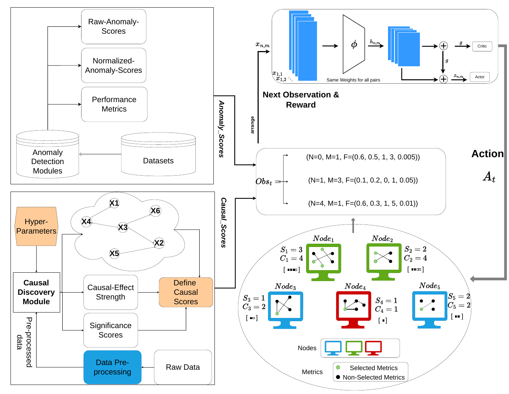

# Adaptive Metric Selection for Monitoring with Reinforcement Learning

<p align="center">
  
  &nbsp;&nbsp;
  
  &nbsp;&nbsp;
  
  &nbsp;&nbsp;
  
</p>

Code for the paper **"Adaptive Metric Selection for Monitoring Cloud–Edge–IoT Continuum Systems Using Reinforcement
Learning"** (Ahmad Atwi, Abdelkader Lahmadi, IEEE WiMob 2026).

Collecting every metric on every node of a Cloud–Edge–IoT system is expensive, especially on edge and IoT devices
with little CPU, memory, bandwidth and energy. This project trains a reinforcement learning agent that decides, at
each monitoring window, **which metrics to collect on which node**. It favours metrics that are anomalous or causally
influential, while keeping the monitoring cost low and staying within each node's monitoring budget.



*Anomaly scores (from an anomaly detection model) and causal scores (from a causal discovery model) describe each
metric. The agent observes them for every node–metric pair and outputs which metrics to monitor in the next window.*

## Method

- **State**: for every node–metric pair, 5 features: anomaly score in the previous window, causal score, whether the
  metric was monitored in the previous window, the node's monitoring capacity, and the metric's monitoring cost.
- **Action**: a binary matrix (nodes × metrics) saying which metrics are monitored in the next window.
- **Reward**: an importance term for selecting anomalous or causally influential metrics, minus penalties for
  exceeding a node's capacity, monitoring cost, unnecessary changes and selecting nothing:
  `r = α·r_imp − β·r_cap − λ·r_cost − δ·r_switch − η·r_idle`.
- **Policy**: a Deep Sets style actor-critic trained with PPO. A shared encoder processes each node–metric pair, the
  pair embeddings are pooled into a global context, and each pair's decision is made from its own embedding plus the
  global context. This lets one network handle any number of nodes and metrics.

Nodes are split into IoT (30%), edge (40%) and cloud (30%) layers. IoT nodes have the smallest budgets and the
highest per-metric cost, cloud nodes the largest budgets and the lowest cost.

The anomaly scores are computed with **LSTM-AD** through [TimeEval](https://github.com/TimeEval/TimeEval), and the
causal scores with **PCMCI+** through [tigramite](https://github.com/jakobrunge/tigramite) (see
[Anomaly and causal scores](#anomaly-and-causal-scores)).

## Results

Synthetic setting with 5 nodes × 7 metrics, mean ± standard deviation over 5 paired seeds (Table I of the paper):

| Anomaly density | Method | ACR ↑ | FMR ↓ | Total coverage ↑ | Selected ↓ | Cost ↓ |
|---|---|---|---|---|---|---|
| 0.05 | Monitor-Everything | 1.000 | 0.883 | 0.209 | 35.0 | 0.700 |
| | TopK-Anomaly-Causal | 0.915 | 0.794 | 0.336 | 18.1 | 0.255 |
| | RL-Flat-MLP | 0.907 | 0.741 | 0.403 | 14.2 | 0.230 |
| | **Ours** | 0.936 | **0.611** | **0.543** | **10.4** | **0.146** |
| 0.25 | Monitor-Everything | 1.000 | 0.533 | 0.636 | 35.0 | 0.700 |
| | TopK-Anomaly-Causal | 0.788 | 0.296 | 0.743 | 18.1 | 0.255 |
| | RL-Flat-MLP | 0.891 | 0.309 | 0.778 | 21.0 | 0.387 |
| | **Ours** | 0.861 | **0.106** | **0.877** | **15.0** | **0.254** |

ACR is the share of anomalous metrics that are monitored, FMR the share of monitored metrics that are not anomalous,
and total coverage the harmonic mean of ACR and 1 − FMR. The learned policy monitors far fewer metrics than
monitoring everything (10 instead of 35 at density 0.05) and gives the best trade-off between coverage and cost.
The paper also reports results at a larger scale (28 nodes × 38 metrics, the size of the Server Machine Dataset)
and a study of the reward weights.

## Setup

```bash
python -m venv .venv && source .venv/bin/activate
pip install -r requirements.txt
```

Python 3.10 and an NVIDIA GPU were used for the experiments; everything also runs on CPU (`--no-cuda` for training, `--device cpu` for `compute_metrics.py`), only
slower. Computing new anomaly scores with LSTM-AD needs TimeEval in a separate environment and Docker (see
`requirements.txt`).

## Quick start

Train the per-metric policy on the 5 × 7 synthetic setting and compare it with the baselines:

```bash
python scripts/train.py --config configs/config_per_metric.yaml --run-name my_run
python scripts/compute_metrics.py --config configs/config_per_metric.yaml --model results/my_run/best_model.pt \
                                  --out-dir results/my_run
```

The episode pool (anomaly scores, causal scores, capacities and costs for each node–metric pair) is generated
automatically on the first run and cached under `data/`. All settings (topology, capacities, costs, reward weights,
PPO hyperparameters, policy size) are in the YAML files in `configs/`.

## Reproducing the experiments

Every experiment trains the flat-MLP and the per-metric policy for 5 paired seeds (data seeds 42–46, training seeds
101–105), evaluates them together with the baselines (Monitor-Everything, Random, TopK-Anomaly-Causal), and writes
the per-seed results to `results/<name>/`. `--max-parallel` runs several seeds at the same time on one GPU.

```bash
# Table I, anomaly density 0.05
python scripts/run_multiseed.py --dataset syn_d005 --seeds 5 --max-parallel 10 \
    --config configs/paper/config_syn_d005_flat.yaml \
    --method-config flat=configs/paper/config_syn_d005_flat.yaml per_metric=configs/paper/config_syn_d005_per_metric.yaml

# Table I, anomaly density 0.25
python scripts/run_multiseed.py --dataset syn_d025 --seeds 5 --max-parallel 10 \
    --config configs/config.yaml \
    --method-config flat=configs/config.yaml per_metric=configs/config_per_metric.yaml

# 28 nodes x 38 metrics
python scripts/run_multiseed.py --dataset n28m38 --seeds 5 --max-parallel 9 \
    --config configs/config_SMD_new_arch.yaml \
    --method-config flat=configs/config_SMD.yaml per_metric=configs/config_SMD_new_arch.yaml
```

Then build the tables (mean ± between-seed standard deviation) and the figures:

```bash
python scripts/aggregate_results.py --input results --dataset syn_d025
python scripts/visualize/visualize_results.py --summary results/syn_d025/summary.csv --out-dir results/syn_d025/figures
```

`aggregate_results.py` writes `summary.csv`, a Markdown table and a LaTeX table. Training takes about 10 hours per
seed for the 5 × 7 setting and 15 hours for 28 × 38 on an RTX A6000.

**Reward ablation (Table II).** `scripts/train_ablation.py` trains the policy with the five reward-weight settings
of Table II on the 10 nodes × 15 metrics setting and prints a comparison table:

```bash
python scripts/train_ablation.py --config configs/config_GutenTAG.yaml
python scripts/train_ablation.py --config configs/config_GutenTAG.yaml --configs importance_only full_reward
```

**About reproducibility.** Seeds fix the generated scenarios, the network initialisation and the rollouts. GPU
training is still not bit-for-bit deterministic (`--deterministic` reduces this at some speed cost), so expect
results close to the paper's rather than identical.

## Anomaly and causal scores

The agent does not detect anomalies or causal relations itself: it takes as input two scores per metric, computed
beforehand by external models on the monitoring time series.

- **Anomaly scores** come from **LSTM-AD**, run through [TimeEval](https://github.com/TimeEval/TimeEval)
  (`outer_models/timeeval_model/`).
- **Causal scores** come from **PCMCI+**, run through [Tigramite](https://github.com/jakobrunge/tigramite)
  (`outer_models/causal_discovery/`). The causal score of a metric sums the strength of its significant outgoing
  causal links over the considered lags.

For the Server Machine Dataset experiments, the agent is trained and evaluated on the scores produced by these two
models.

### Your own data

The pipelines read datasets in the layout of the Server Machine Dataset (one file per machine for train, test and
labels). Scores saved as single arrays, `anomaly_scores.npy` (`[T, N, M]`) and `causal_scores.npy` (`[N, M]`), can be
evaluated with:

```bash
python scripts/compute_metrics.py --config <config.yaml> --model <best_model.pt> \
    --source npy --anomaly-scores anomaly_scores.npy --causal-scores causal_scores.npy --labels labels.npy \
    --out-dir results/my_data
```

## Repository structure

```
agents/          per-metric (Deep Sets) and flat actor-critic policies, PPO trainer
envs/            monitoring environment (gymnasium): state, action, reward
baselines/       Monitor-Everything, Random, TopK-Anomaly-Causal
data/            synthetic episode generator, raw synthetic telemetry generator
outer_models/    LSTM-AD (TimeEval) anomaly scores, PCMCI+ causal scores
configs/         experiment settings; configs/paper/ holds the settings of the density-0.05 runs
scripts/         training, multi-seed runs, evaluation, aggregation, ablation, figures
utils/           seeding and run records
```

## Citation

```bibtex
@inproceedings{atwi2026adaptive,
  title     = {Adaptive Metric Selection for Monitoring Cloud--Edge--IoT Continuum Systems Using Reinforcement Learning},
  author    = {Atwi, Ahmad and Lahmadi, Abdelkader},
  booktitle = {IEEE International Conference on Wireless and Mobile Computing, Networking and Communications (WiMob)},
  year      = {2026}
}
```

This work was partially funded by the French ANR under the France 2030 program, project SPIREC of PEPR Cloud
(ANR-23-PECL-0006).
